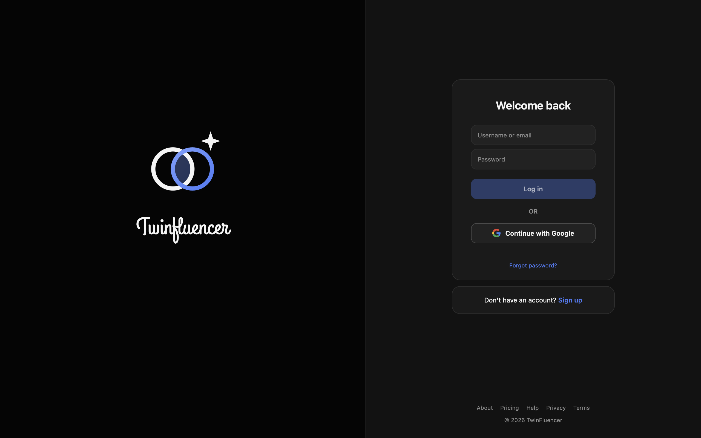
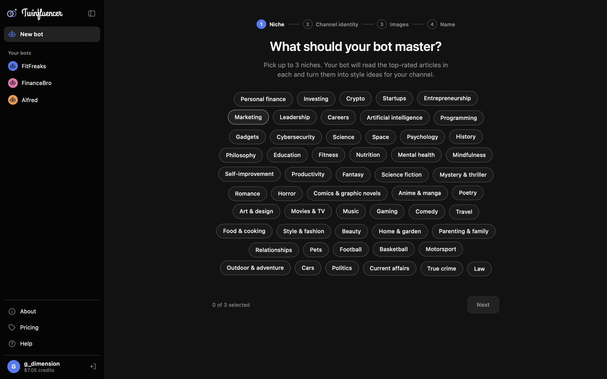
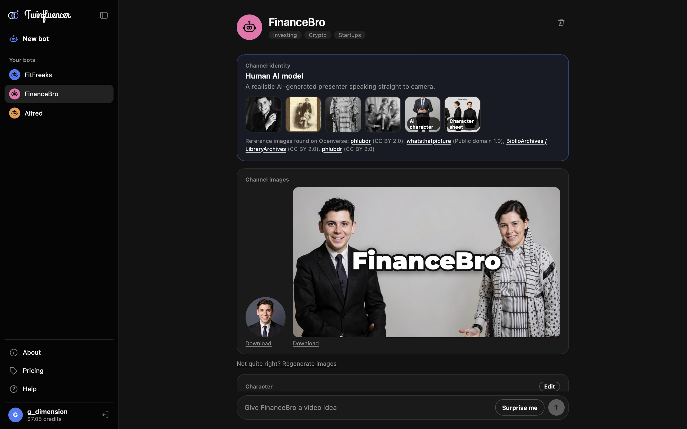
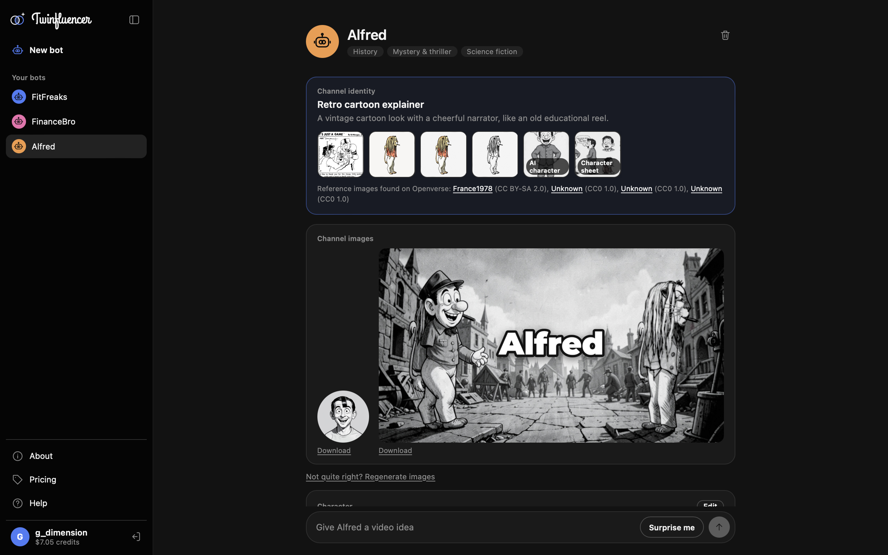
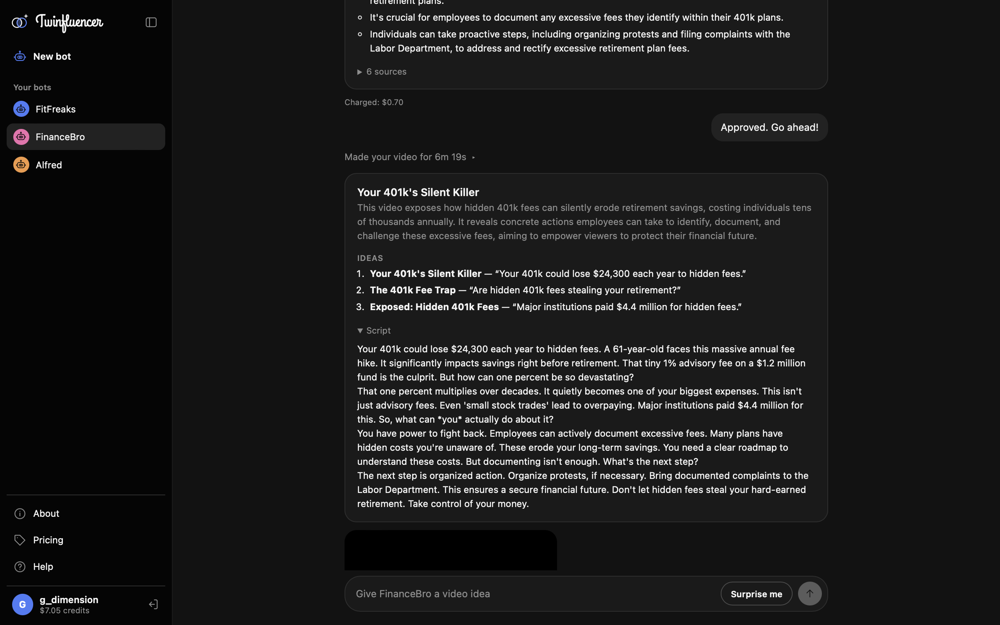
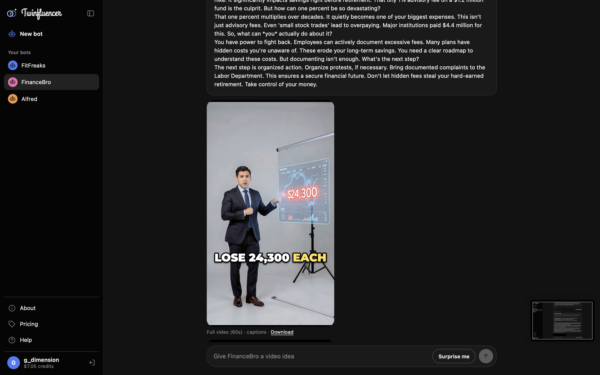

# Twinfluencer


> [!NOTE]
> Unlike my other projects, which I write myself, this one was built with
> heavy use of AI coding tools (Claude Code). Much of the code was written
> by AI.

Twinfluencer is a platform for building content bots around a niche. Each bot
researches the top articles and books in its field, turns what it learns into
ideas and scripts, and produces finished one-minute videos with its own
recurring characters.



## Screenshots

**Pick a niche.** Each bot focuses on up to three niches.



**Give each channel an identity.** Reference images found on Openverse shape
the AI character, character sheet, profile picture and banner.

| Human AI model | Retro cartoon explainer |
|---|---|
|  |  |

**From research to finished video.** The bot cites its sources, proposes
ideas and writes the script; once you approve, it renders a captioned
60-second video.

| Ideas and script | Finished video |
|---|---|
|  |  |

## How it works

1. **Create a bot.** Pick a niche (personal finance, fitness, startups…), define
   the channel's identity (voice, tone, personality), and design one or two
   characters. The bot draws a permanent character portrait.
2. **Research.** The bot plans searches, reads news and Hacker News articles and
   book summaries in parallel, stores what it learns in a knowledge base
   (pgvector + local embeddings), and proposes ideas for you to approve.
3. **Production.** From an approved idea it writes a two-scene script, plans
   the shots, and renders two 30-second Kling 4.0 clips. Kling speaks the lines
   itself, with lip-sync, using the character images and the previous clip as
   references. The clips are stitched into a 60-second video with a title
   banner and captions.

Jobs live in the database, so they keep running after the browser closes, and a
run whose worker died is picked up again automatically. Each step is charged in
credits as it finishes.

## Stack

| Part      | Tech |
|-----------|------|
| Client    | React 19, React Router, Vite, TypeScript |
| Server    | Node, Express 5, TypeScript (`tsx` in dev) |
| Database  | PostgreSQL 17 with pgvector (Docker) |
| AI models | [Replicate](https://replicate.com): GPT-5 nano (writing), GPT Image 2 (frames), Kling 4.0 (video), Gemini 2.5 Flash (vision), with fallbacks |
| Media     | ffmpeg / ffprobe for stitching, `@napi-rs/canvas` for captions and titles |

## Getting started

### Prerequisites

- Node.js 22+
- Docker (for Postgres)
- ffmpeg and ffprobe on your `PATH` (or set `FFMPEG_PATH` / `FFPROBE_PATH`)
- A Replicate API token

### Setup

```bash
# 1. Configure environment
cp .env.example .env
# then edit .env: set POSTGRES_PASSWORD (and the same in DATABASE_URL) and REPLICATE_API_TOKEN

# 2. Start the database
docker compose up -d db

# 3. Start the API (runs database migrations on startup)
cd server
npm install
npm run dev          # http://localhost:4000

# 4. Start the client, in another terminal
cd client
npm install
npm run dev          # Vite dev server, proxies /api to :4000
```

The first run downloads the local embedding model; set `MODEL_CACHE_DIR` to
choose where it is cached.

### Adding credits

There are no real payments yet. Grant credits from the command line:

```bash
cd server
npm run credits -- <username> <basic|plus|pro|studio>   # a credit pack
npm run credits -- <username> <dollars>                 # a plain amount
```

## Configuration

All settings are read from `.env` at the repo root.

| Variable | Purpose |
|----------|---------|
| `POSTGRES_DB`, `POSTGRES_USER`, `POSTGRES_PASSWORD` | Database container credentials |
| `DATABASE_URL` | Connection string the server uses |
| `PORT` | API port (default `4000`) |
| `REPLICATE_API_TOKEN` | Required for all AI generation |
| `REPLICATE_LLM_MODEL`, `REPLICATE_WRITER_MODEL`, `REPLICATE_IMAGE_MODEL`, `REPLICATE_VIDEO_MODEL`, `REPLICATE_VISION_MODEL` | Optional overrides of the default models |
| `FFMPEG_PATH`, `FFPROBE_PATH` | Optional paths to ffmpeg binaries |
| `MODEL_CACHE_DIR` | Optional cache folder for the local embedding model |

## Project layout

```
client/              React app (landing, pricing, help, dashboard)
  src/pages/DashboardPage/   bot creation, characters, voices, runs
server/
  db/                Postgres + pgvector image and SQL migrations
  src/
    index.ts         Express app entry point
    worker.ts        background job runner: character, research, production
    replicate.ts     model calls, fallbacks and retries
    stitch.ts        ffmpeg clip joining
    captions.ts      transcription-based captions
    typeset.ts       title banner
    credits.ts       pricing, holds and charges
    knowledge.ts     pgvector knowledge base
    scripts/         CLI tools (credits, SSRF check)
docker-compose.yml   Postgres service
```

## Scripts

| Where | Command | What it does |
|-------|---------|--------------|
| server | `npm run dev` | API with hot reload |
| server | `npm run build` / `npm start` | Compile and run in production |
| server | `npm run credits` | Grant credits to a user |
| server | `npm run check:ssrf` | Check the URL-fetching guard against private addresses |
| client | `npm run dev` | Vite dev server |
| client | `npm run build` | Type-check and build for production |
| client | `npm run lint` | Lint with oxlint |
